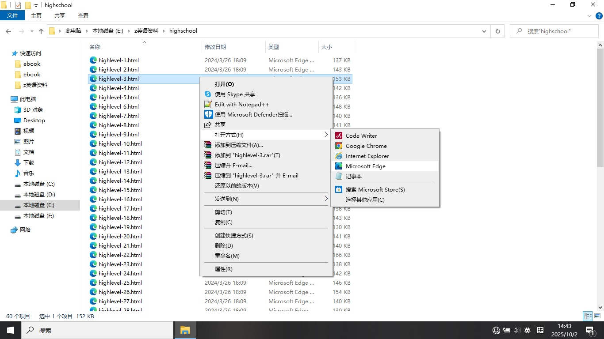
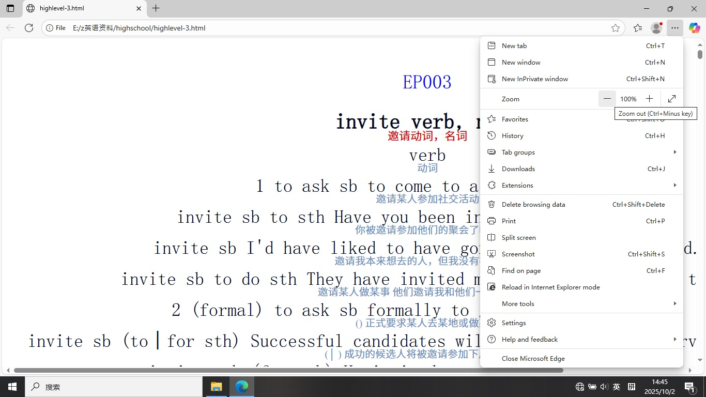
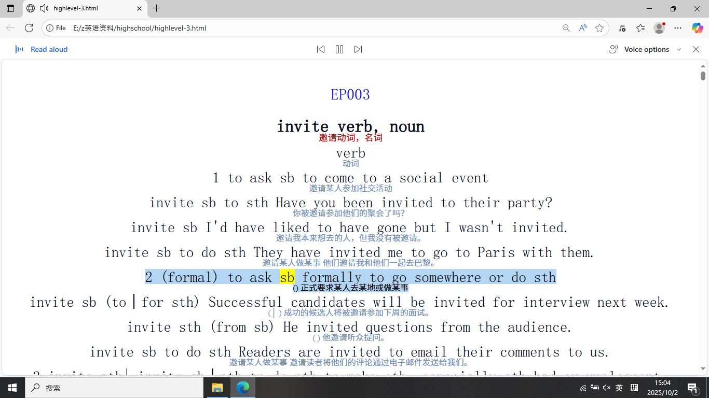
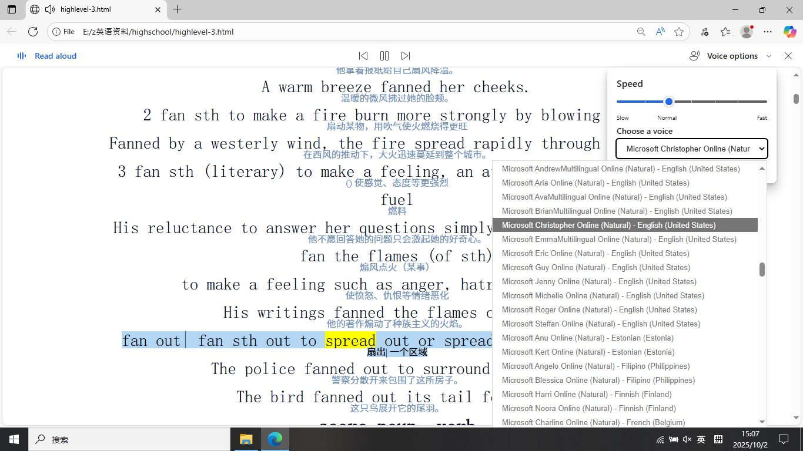
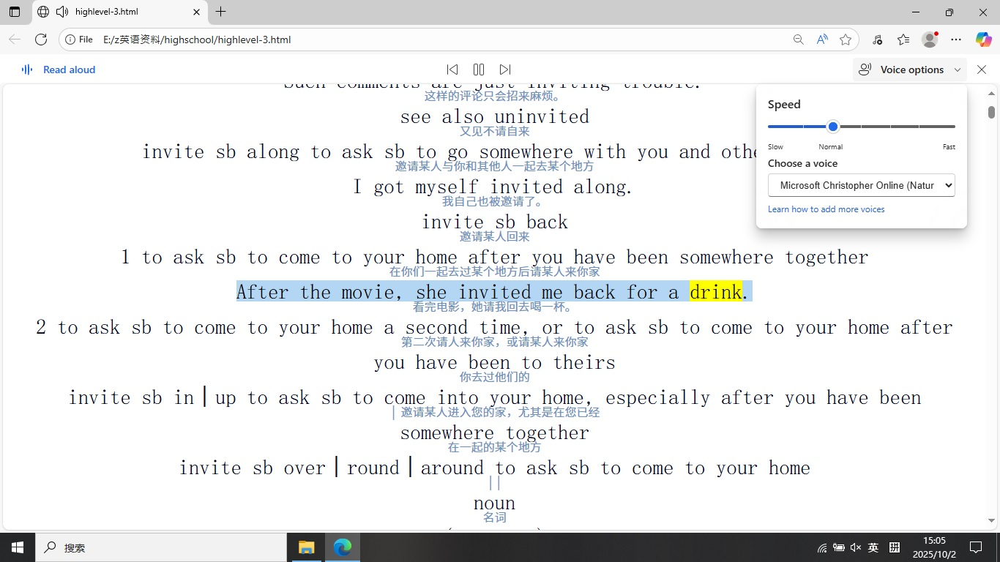

# 00001号用例：使用浏览器自动朗读英文HTML调校

使用 Chrome 和 Brave 浏览器需要单独配置插件。如果有必要，以后会单独给出调校方法。这里以 Edge 浏览器为例进行简要说明。

## 使用方法

### 1. 打开文件

鼠标右键点击目标 HTML 文件，选择“打开方式”，然后选择 **Edge**。
  

### 2. 调整页面大小

点击浏览器菜单中的“+”或“-”，放大或缩小页面；或者使用快捷键 `Ctrl` + `+` / `Ctrl` + `-`，将页面调节到文字内容居于屏幕中间为止。
  

### 3. 联网和刷新页面

如果之前已经联网，可忽略此步骤。联网后，按下 `F5` 刷新页面（确保加载在线自然语音包）。

### 4. 朗读页面内容

使用快捷键 `Ctrl` + `Shift` + `U`，开始自动朗读页面内容。
   

### 5. 选择朗读声音

在顶部朗读控制栏的“语音选项”中，选择 **Online English (United States)** 或 **Online English (United Kingdom)** 语音包。
  

### 6. 调节朗读速率

在顶部朗读控制栏中，根据自己对英文的理解熟练度，自由调节朗读语速。
  

## 提示

1.调节阅读位置：开启朗读后，如需调整进度，可滑动滚动条找到目标段落，直接用鼠标点击对应的英文单词，即可从该处继续朗读。  
2.关于中文翻译：页面中的中文翻译均由软件自动生成，存在一定误差，仅供辅助理解。  
3.优化朗读流畅度：联网状态下，Edge 后台可能会持续收集信息并占用带宽，从而打断朗读节奏。为获得最流畅的听读体验，建议在浏览器设置中关闭所有非必要的优化与后台功能，同时隐藏地址栏旁边的搜索框（如 Copilot 或侧边栏搜索）。
